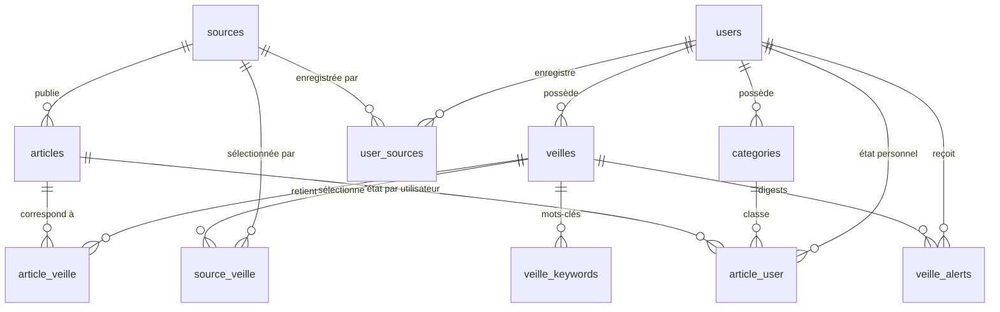

# DataModel.md — Modèle de données métier (MVP) — v3.4

> Missions M1.5.2 (v3), M1.5.3 (v3.1), M1.5.4 (v3.2), M1.5.5 (v3.3) puis
> M1.5.6 (v3.4 — dernière revue documentaire avant implémentation).
> Architecture générale inchangée et validée.
> Conception uniquement : aucune implémentation, aucune migration avant
> validation explicite de Gaël.

## 0. Changements successifs

### v3.3 → v3.4

| # | Problème v3.3 | Correction v3.4 |
|---|---|---|
| C27 | La suppression d'une ligne « sans nouveauté » n'était pas conditionnée par la réservation | `DELETE` soumise à `id` + `status='processing'` + `reservation_token` — cohérent avec la protection de toutes les écritures post-réservation — §4.C |
| C28 | Fuseau de **session** MariaDB non spécifié : `NOW()`/conversions implicites des `TIMESTAMP` possibles selon `time_zone` de session | Exigence documentée : sessions Laravel fixées à **`+00:00`** ; à vérifier sur MariaDB 10.11 à l'implémentation ; colonnes `TIMESTAMP` conservées — §3, §4.C, §11 |

### v3.2 → v3.3

| # | Problème v3.2 | Correction v3.3 |
|---|---|---|
| C22 | Worker dont la réservation a expiré puis été reprise pouvait encore écrire `sent`/`failed`/`pending` | **`reservation_token` char(36) UUID** : toute écriture ultérieure conditionnée par `WHERE id AND reservation_token=:token` — 0 ligne = réservation perdue — §3.11, §4.C |
| C23 | Réservations expirées / `reserved_at IS NULL` sous-spécifiées | Reprise précisée (verrou parent + nouveau jeton) ; `NULL` traité comme expiré — §4.C |
| C24 | Références ambiguës à `now` dans les règles | Remplacées par `UTC_TIMESTAMP(6)` — §4.A, §4.D |
| C25 | §5.2 citait « réservation atomique sur `status` » comme garantie inter-worker | Reformulé : transaction + verrou `FOR UPDATE` parent + contrôle de réservation + jeton — §5.2 |
| C26 | Préparation du passage à l'implémentation absente | §11 « Validation et prochaine étape » ajoutée |

### v3.1 → v3.2

| # | Problème v3.1 | Correction v3.2 |
|---|---|---|
| C18 | `NOT EXISTS` seul dans un `UPDATE` n'exclut pas deux workers réservant deux lignes différentes d'une même veille (évaluation non sérialisée) | **Protocole transactionnel obligatoire** : `SELECT … FOR UPDATE` sur la ligne `veilles` parente = sérialisation principale ; le `NOT EXISTS` devient contrôle complémentaire — §4.C |
| C19 | Précisions temporelles hétérogènes entre bornes de digest et `created_at` des correspondances | `article_veille.created_at` et `veilles.created_at` passés en **`timestamp(6)`** ; convention UTC/`UTC_TIMESTAMP(6)` conservée — §3.4, §3.8, §3.11 |
| C20 | Fragment `#…` conservé sur `feed_url` alors qu'il n'est pas transmis HTTP | Fragment supprimé en normalisation B.1 ; paramètres de requête intégralement conservés — §4.B.1 |
| C21 | Cycle des tentatives incomplet : reprise des lignes après échec non définie | Cycle explicite `pending → processing → (échec) → pending|failed`, `failed` = terminal au plafond de 3 ; même verrou parent anti-double-reprise — §4.C |

### v3 → v3.1

| # | Problème v3 | Correction v3.1 |
|---|---|---|
| C11 | `article_user.user_id` sans FK déclarée vers `users` | FK `user_id → users.id` CASCADE explicite — §3.9 |
| C12 | Deux digests `processing` simultanés d'une même veille possibles | Réservation atomique avec prédicat anti-concurrence par veille + fenêtres non chevauchantes — §4.C |
| C13 | Référence orpheline `§4.B-normalisation` ; normalisation `feed_url`/articles confondues | Deux règles distinctes **B.1/B.2** — §3.2, §4.B |
| C14 | Listes d'IP « exhaustives » (approche denylist, jamais complète) | Politique **allowlist** : seules les IP **globalement routables** autorisées — §4.G |
| C15 | Ambiguïtés temporelles (`NOW()` vs `UTC_TIMESTAMP()`) | Convention UTC unifiée, bornes `timestamp(6)` — §3, §4.C |
| C16 | Fusion silencieuse de deux articles possible lors d'un changement de clé | Règles strictes : jamais de fusion ; cas de collision déterministes — §4.B |
| C17 | Retrait d'une source perso également au catalogue : non défini | Cas distingués (accès conservé vs perdu) — §4.A |

### v2 → v3

| # | Problème v2 | Correction v3 |
|---|---|---|
| C1 | `ON DELETE SET NULL` sur la FK composite `(user_id,category_id)` : mettrait aussi `user_id` à NULL → ligne corrompue | FK en **RESTRICT** ; suppression de catégorie = transaction applicative (NULL d'abord, DELETE ensuite) — §3.9, §4.F |
| C2 | Index des FK composites partiellement implicites | Chaque FK composite déclare **explicitement** l'index parent `UNIQUE` et l'index enfant — §3, §6 |
| C3 | Outbox « pending → sent/failed » trop naïve : double worker, crash post-SMTP, nouveautés répétées | Statut `processing` + `reserved_at` (réservation atomique à expiration), `period_start`/`period_end` figés à la réservation → borne anti-répétition ; garantie reformulée **at-least-once** — §3.11, §4.C |
| C4 | Retrait d'une source perso utilisée par une veille : non défini | Opération transactionnelle : `user_sources` + `source_veille` de mes veilles + rematch — §4.A |
| C5 | Contradiction d'accès : articles via `article_veille` vs favoris/notes dans `article_user` | Modèle d'accès explicite : `article_user` donne un droit d'accès autonome (favoris/notes/catégories survivent à la correspondance) — §4.D bis |
| C6 | Dédup : normalisation et collisions insuffisamment spécifiées | Normalisation URL, collisions `title|published_at`, changements GUID/URL, collisions de clé — §4.B |
| C7 | SSRF : DNS rebinding et cas IPv6 non couverts | IP figée à la connexion, normalisation IPv4-mappées, listes IPv4/IPv6 complètes, redirections revalidées, TLS/proxy client — §4.G |
| C8 | Rétention : lus/archivés ambigus, date de référence absente | Référence `COALESCE(published_at, collected_at)` ; lus/archivés non protégés ; critères explicites — §4.E |
| C9 | Fuseau horaire des digests non défini | `digest_date` calculée en **Europe/Paris** ; timestamps stockés UTC — §4.C |
| C10 | Grâce 7 jours du garbage-collect sans marqueur | `sources.orphaned_at` — §3.2, §4.F |

Décisions intégrées : D1–D17 **actées** (voir §8, statut « validée »).

## 1. Synthèse fonctionnelle

- **Mutualisation technique** : `sources`/`articles` communes — un flux
  téléchargé une fois, un article en un exemplaire. **Aucun droit attaché.**
- **Droits séparés** : accès = `user_sources` (personnel) ∪ `is_catalogue`
  (plateforme). Jamais de publication implicite d'une source personnelle.
- **`veilles`** = racine privée ; ses enfants portent `user_id`
  dénormalisé + FK composite → `veilles(id,user_id)` : la base refuse les
  lignes rattachées au mauvais tenant.
- **Matching persisté** (`article_veille`) calculé à l'ingestion ; recalcul
  par différence d'ensembles (fenêtre 6 mois — D15).
- **Accès article double voie** : via correspondances de mes veilles
  **ou** via mon `article_user` (favoris/notes/catégories survivent à la
  suppression de la correspondance).
- **Digests quotidiens Europe/Paris** via outbox `veille_alerts` —
  at-least-once, réservation verrouillée, jamais d'envoi sans nouveauté,
  ≤ 50 nouveautés/digest.
- Aucune logique pédagogique.

## 2. Schéma relationnel



## 3. Dictionnaire de données

Conventions : `bigint unsigned` PK, `utf8mb4`, InnoDB, `timestamps` sauf
mention contraire. MariaDB 10.11 : une FK composite exige un index
**unique** côté parent (préfixe gauche) **et** un index côté enfant
même préfixe — **tous déclarés explicitement**, sans compter sur
l'auto-création d'InnoDB.

**Convention temporelle unique** : tous les timestamps sont stockés **UTC** ;
toute colonne intervenant dans les bornes de nouveauté est en
`timestamp(6)` (microsecondes) — `veille_alerts.period_start`,
`period_end`, `reserved_at`, `sent_at`, `article_veille.created_at`,
`veilles.created_at` ; toute comparaison temporelle utilise
**`UTC_TIMESTAMP(6)`** — jamais `NOW()` (dépendant du fuseau de session).
Seule `digest_date` est calculée dans le fuseau logique `Europe/Paris`
(§4.C). Les autres timestamps restent en précision seconde.

**Fuseau de session MariaDB** : les colonnes `TIMESTAMP` convertissent
implicitement selon la variable `time_zone` **de session** ; les
connexions Laravel à MariaDB doivent donc être fixées explicitement à
**`+00:00`** (option de connexion), pour que stockage et comparaisons
restent strictement UTC. Les colonnes `TIMESTAMP` sont **conservées** —
pas de bascule en `DATETIME` ; l'exigence porte sur la session, à
vérifier sur MariaDB 10.11 à l'implémentation (§11).

### 3.1 `users` — *(existante, non modifiée)*

`id`, `name`, `email` UNIQUE, `email_verified_at`, `password`,
`remember_token`, timestamps.

### 3.2 `sources` — identité technique des flux (sans propriétaire)

| Colonne | Type | Null | Défaut | Notes |
|---|---|---|---|---|
| `id` | bigint unsigned PK | — | auto | |
| `feed_url` | varchar(512) | non | — | **UNIQUE**, normalisée selon §4.B.1 |
| `name` | varchar(255) | non | — | titre du flux |
| `site_url` | varchar(512) | oui | NULL | |
| `description` | varchar(500) | oui | NULL | |
| `is_catalogue` | tinyint(1) | non | 0 | proposition plateforme (admin uniquement) |
| `is_active` | tinyint(1) | non | 1 | |
| `etag` | varchar(255) | oui | NULL | validateur HTTP |
| `last_modified` | varchar(255) | oui | NULL | validateur HTTP |
| `last_fetched_at` | timestamp | oui | NULL | |
| `last_success_at` | timestamp | oui | NULL | |
| `fail_count` | smallint unsigned | non | 0 | échecs consécutifs → backoff |
| `last_error` | varchar(500) | oui | NULL | |
| `orphaned_at` | timestamp | oui | NULL | marqueur « orphelin » → grâce 7 j puis GC (D16) |
| timestamps | | | | |

- **Index** : `UNIQUE(feed_url)` ; `(is_active, last_fetched_at)` ;
  `is_catalogue` ; `orphaned_at` (GC).

### 3.3 `user_sources` — enregistrement personnel d'une source

| Colonne | Type | Null | Notes |
|---|---|---|---|
| `id` | bigint unsigned PK | — | auto |
| `user_id` | bigint unsigned FK → `users.id` | non | CASCADE |
| `source_id` | bigint unsigned FK → `sources.id` | non | CASCADE |
| `custom_name` | varchar(255) | oui | NULL (D17) |
| `created_at` | timestamp | non | |

- **Index** : `UNIQUE(user_id, source_id)` (couvre les deux FK côté enfant :
  préfixe `user_id`, et `source_id` via index secondaire) ; `INDEX(source_id)`.

### 3.4 `veilles` — espaces de veille personnels

| Colonne | Type | Null | Défaut | Notes |
|---|---|---|---|---|
| `id` | bigint unsigned PK | — | auto | |
| `user_id` | bigint unsigned FK → `users.id` | non | — | CASCADE |
| `name` | varchar(255) | non | — | |
| `description` | varchar(500) | oui | NULL | |
| `is_active` | tinyint(1) | non | 1 | pause : matching ET alertes suspendus (D11) |
| `alerts_enabled` | tinyint(1) | non | 0 | digest quotidien (D3) |
| `created_at`/`updated_at` | timestamp(6) | | | `created_at` = **borne initiale** de `period_start` (§4.C) → précision microseconde requise (`timestamps(6)`) |

- **Index** : `UNIQUE(user_id, name)` ; **`UNIQUE(id, user_id)`** — index
  parent des FK composites ; `(alerts_enabled, is_active)` ; `user_id`
  (FK enfant explicite).

### 3.5 `veille_keywords` — mots-clés

| Colonne | Type | Null | Notes |
|---|---|---|---|
| `id` | bigint unsigned PK | — | auto |
| `veille_id` | bigint unsigned | non | membre 1 FK composite |
| `user_id` | bigint unsigned | non | tenant dénormalisé |
| `term` | varchar(255) | non | normalisé (trim + minuscules) |
| timestamps | | | |

- **FK** : `(veille_id, user_id) → veilles(id, user_id)` ON DELETE CASCADE.
- **Index** : `UNIQUE(veille_id, term)` ; **`INDEX(veille_id, user_id)`**
  (index enfant explicite de la FK) ; `INDEX(user_id)`.

### 3.6 `source_veille` — pivot veille ↔ sources

| Colonne | Type | Null | Notes |
|---|---|---|---|
| `veille_id` | bigint unsigned | non | membre 1 PK + FK composite |
| `source_id` | bigint unsigned | non | membre 2 PK ; FK → `sources.id` CASCADE |
| `user_id` | bigint unsigned | non | tenant dénormalisé |

- **PK** `(veille_id, source_id)` ; **FK** `(veille_id, user_id) →
  veilles(id, user_id)` CASCADE.
- **Index** : `INDEX(source_id)` (FK enfant + lookup inverse matching) ;
  **`INDEX(veille_id, user_id)`** (index enfant explicite — le PK ne
  suffit pas : colonnes dans un ordre différent).
- **Limite honnête** : SQL garantit le tenant, **pas** l'accessibilité de
  la source — règle applicative (`is_catalogue` ∪ `user_sources`), §5.

### 3.7 `articles` — contenus collectés, mutualisés

| Colonne | Type | Null | Défaut | Notes |
|---|---|---|---|---|
| `id` | bigint unsigned PK | — | auto | |
| `source_id` | bigint unsigned FK → `sources.id` | non | — | RESTRICT (§4.F) |
| `guid` | varchar(512) | oui | NULL | identifiant déclaré, instable |
| `dedup_key` | char(64) | non | — | sha256 du meilleur identifiant (§4.B) |
| `url` | varchar(2048) | non | — | lien canonique |
| `url_hash` | char(64) | non | — | sha256(url normalisée) — secours dédup |
| `content_hash` | char(64) | oui | NULL | détection de modification |
| `title` | varchar(512) | non | — | |
| `author` | varchar(255) | oui | NULL | |
| `summary` | text | oui | NULL | |
| `content` | longtext | oui | NULL | brut, assaini à l'affichage |
| `published_at` | timestamp | oui | NULL | absente de certains flux |
| `collected_at` | timestamp | non | — | ingestion (UTC) |
| timestamps | | | | |

- **Index** : `UNIQUE(source_id, dedup_key)` ;
  `INDEX(source_id, url_hash)` ; `INDEX(source_id, published_at)` ;
  `INDEX(published_at)` ; `INDEX(collected_at)` ; `INDEX(source_id)`.

### 3.8 `article_veille` — correspondances persistées

| Colonne | Type | Null | Notes |
|---|---|---|---|
| `veille_id` | bigint unsigned | non | membre 1 PK + FK composite |
| `article_id` | bigint unsigned FK → `articles.id` | non | CASCADE ; membre 2 PK |
| `user_id` | bigint unsigned | non | tenant dénormalisé |
| `matched_keyword` | varchar(255) | oui | terme déclencheur (D8) |
| `created_at` | timestamp(6) | non | **préservé au rematch** ; précision microseconde — comparée aux bornes `timestamp(6)` des digests |

- **PK** `(veille_id, article_id)` ; **FK** `(veille_id, user_id) →
  veilles(id, user_id)` CASCADE.
- **Index** : `INDEX(article_id)` (FK + cascade) ;
  **`INDEX(veille_id, user_id)`** (FK composite enfant) ;
  `INDEX(veille_id, created_at)` (nouveautés/digest).

### 3.9 `article_user` — état personnel

| Colonne | Type | Null | Défaut | Notes |
|---|---|---|---|---|
| `user_id` | bigint unsigned FK → `users.id` | non | — | CASCADE ; membre 1 PK |
| `article_id` | bigint unsigned FK → `articles.id` | non | — | CASCADE ; membre 2 PK |
| `category_id` | bigint unsigned | oui | NULL | membre 2 FK composite catégories |
| `is_read` | tinyint(1) | non | 0 | non lu = pas de ligne OU 0 |
| `is_favorite` | tinyint(1) | non | 0 | protège de la purge |
| `is_archived` | tinyint(1) | non | 0 | masque ; **ne protège pas** |
| `note` | text | oui | NULL | protège de la purge |
| timestamps | | | | |

- **PK** `(user_id, article_id)` — sa colonne de tête `user_id` sert
  d'index enfant à la FK `user_id → users.id` (CASCADE, cohérent avec la
  suppression de compte §4.F) ; aucun index supplémentaire requis.
- **FK composite** : `(user_id, category_id) → categories(user_id, id)`
  **ON DELETE RESTRICT** — `SET NULL` impossible (mettrait `user_id` à
  NULL). La catégorie NULL (non classé) est exemptée du contrôle.
  La suppression de catégorie suit §4.F (transaction).
- **Index** : `INDEX(article_id)` (FK) ; **`INDEX(user_id, category_id)`**
  (index enfant explicite de la FK + navigation catégories) ;
  `INDEX(user_id, is_favorite)`.

### 3.10 `categories` — classement personnel

| Colonne | Type | Null | Notes |
|---|---|---|---|
| `id` | bigint unsigned PK | — | auto |
| `user_id` | bigint unsigned FK → `users.id` | non | CASCADE |
| `name` | varchar(100) | non | |
| timestamps | | | |

- **Index** : `UNIQUE(user_id, name)` ;
  **`UNIQUE(user_id, id)`** — index parent de la FK composite
  d'`article_user` ; `INDEX(user_id)`.

### 3.11 `veille_alerts` — outbox de digests (at-least-once)

| Colonne | Type | Null | Défaut | Notes |
|---|---|---|---|---|
| `id` | bigint unsigned PK | — | auto | identifiant de réservation |
| `veille_id` | bigint unsigned | non | — | membre 1 FK composite |
| `user_id` | bigint unsigned | non | — | tenant dénormalisé |
| `digest_date` | date | non | — | jour logique **Europe/Paris** |
| `status` | enum('pending','processing','sent','failed') | non | 'pending' | machine d'état |
| `period_start` | timestamp(6) | oui | NULL | borne basse figée à la réservation |
| `period_end` | timestamp(6) | oui | NULL | borne haute figée à la réservation |
| `articles_count` | smallint unsigned | non | 0 | |
| `attempts` | tinyint unsigned | non | 0 | |
| `reserved_at` | timestamp(6) | oui | NULL | verrou : NULL ou expiré → reprenable |
| `reservation_token` | char(36) | oui | NULL | UUID de la réservation en cours — conditionne toute écriture ultérieure (§4.C) |
| `error` | varchar(500) | oui | NULL | dernière erreur |
| `sent_at` | timestamp(6) | oui | NULL | succès (UTC) |
| timestamps | | | | |

- **Index** : `UNIQUE(veille_id, digest_date)` — idempotence journalière ;
  `INDEX(veille_id, status, reserved_at)` — supports la réservation
  anti-concurrence par veille (§4.C) ; `INDEX(user_id, sent_at)` ;
  **`INDEX(veille_id, user_id)`** (FK composite enfant).
- **FK** : `(veille_id, user_id) → veilles(id, user_id)` CASCADE.
- **Invariant** : un seul digest `processing` **non expiré** par veille à
  un instant donné — garanti par le **verrou `FOR UPDATE` sur la ligne
  `veilles` parente** (sérialisation principale §4.C) ; le `NOT EXISTS`
  applicatif n'est qu'un contrôle complémentaire. Pas d'index unique
  partiel en MariaDB.
- **`reservation_token`** : non indexé — les écritures passent par le PK
  `id` + condition sur le jeton (§4.C).

## 4. Règles métier

### 4.A Sources — identité vs droits vs catalogue

- **Accès à une source** = `is_catalogue=1` OU ligne `user_sources`.
- **Ajout** : validation SSRF (§4.G) → normalisation → `INSERT` ;
  clash `UNIQUE(feed_url)` → rattacher l'existant à `user_sources`.
- **Retrait d'une source personnelle encore utilisée par des veilles**
  (transaction unique) :
  1. `DELETE source_veille WHERE user_id = moi AND source_id = s` ;
  2. `DELETE user_sources WHERE user_id = moi AND source_id = s` ;
  3. rematch par différence d'ensembles (§4.D) des veilles touchées —
     les correspondances qui n'existent plus que par cette source sont
     retirées ; celles encore valides via d'autres sources conservent
     leur `created_at`.
  Tout ou rien : jamais de `source_veille` pointant vers une source
  devenue inaccessible.
- **Cas particulier — la source est aussi `is_catalogue=1`** : retirer ma
  ligne `user_sources` ne coupe **pas** mon accès (le catalogue le
  conserve). Deux intentions distinctes, deux opérations :
  - *ne plus l'enregistrer personnellement* → simple `DELETE user_sources`
    (la source reste utilisable via le catalogue ; mes `source_veille`
    et correspondances sont intactes) ;
  - *la retirer de mes veilles* → désélection classique :
    `DELETE source_veille WHERE user_id = moi AND source_id = s` + rematch
    (§4.D) — la transaction complète ci-dessus n'est requise que lorsque
    l'accès est réellement perdu (source non catalogue).
- **Catalogue** : `is_catalogue` modifiable uniquement par un
  administrateur — jamais d'auto-promotion d'une source personnelle.
- **Collecte** : toutes les 15 min (D12) par flux, indépendante des
  abonnés ; ETag/Last-Modified ; `fail_count` + backoff ; seuil →
  `is_active=0`.
- **GC** : job hebdomadaire — source sans `user_sources`, `source_veille`,
  ni `articles`, et `is_catalogue=0` → `orphaned_at` posé ; suppression
  si `orphaned_at < UTC_TIMESTAMP(6) − INTERVAL 7 DAY` et toujours
  orpheline (D16). Toute nouvelle référence remet `orphaned_at` à NULL.

### 4.B Articles — déduplication

#### B.1 Normalisation des `feed_url` (identité technique)

Canonisation **conservatrice** — elle identifie le point de collecte :
trop normaliser risquerait de fusionner deux flux réellement distincts.

- schéma et hôte en minuscules ; port par défaut retiré (`:80`/`:443`) ;
- slash terminal racine normalisé (`https://ex.com/` ≡ `https://ex.com`) ;
- **fragment `#…` supprimé** — il n'est jamais transmis dans la requête
  HTTP (traitement côté client) : deux `feed_url` ne différant que par le
  fragment désignent le même point de collecte ;
- `http://` → `https://` sur même hôte+chemin quand le HTTPS répond
  (résolu au fetch, pas à l'insert) ;
- **paramètres de requête intégralement conservés** : ils peuvent
  identifier des flux différents (`?feed=atom` ≠ `?feed=rss`) — aucun
  strip, aucun réordonnancement sur `feed_url`.

#### B.2 Normalisation des URL d'articles (`url_hash`, secours dédup)

Canonisation **agressive bornée** — elle sert uniquement à reconnaître
« le même article » :

- schéma et hôte en minuscules ; port par défaut retiré ;
- fragment `#…` supprimé ;
- paramètres de tracking retirés (`utm_*`, `fbclid`, `gclid`, `mc_*`) —
  liste bornée, pas de réordonnancement des paramètres métier ;
- `www.` initial de l'hôte supprimé.

#### B.3 Calcul de `dedup_key` et gestion des changements

- **`dedup_key`** = sha256 du premier de : `guid` si `isPermaLink=true` →
  `url` normalisée (B.2) → `title|published_at|summary[:120]`.
- **Changement de résumé/contenu** (clé inchangée) : `content_hash`
  diffère → update de la **même ligne** (`updated_at` rafraîchi,
  `collected_at` et états `article_user` préservés).
- **Changement de GUID** : nouveau `dedup_key` calculé ; si une **seule**
  ligne de la même source porte le même `url_hash` → cette ligne est
  l'article : on y met à jour `guid`/`dedup_key`/`url`. Si **plusieurs**
  lignes partagent ce `url_hash` → ambiguïté : **aucune fusion**, le
  nouvel item est inséré comme ligne distincte.
- **Changement d'URL** : `dedup_key` inchangé (issu du GUID) → simple
  update `url`/`url_hash`. Si la clé était dérivée de l'URL et que l'URL
  change sans GUID stable → nouvelle ligne (limite documentée :
  indistinguable d'un nouvel article sans identifiant fiable).
- **Collision de clé lors d'une mise à jour** : si le nouveau `dedup_key`
  existe déjà sur une **autre** ligne → pas d'écrasement ni de fusion :
  la ligne au plus ancien `id` est conservée avec sa clé ; la ligne
  entrante conserve la sienne ; l'anomalie est journalisée. **Jamais de
  fusion silencieuse** de deux lignes : `article_user`/`article_veille`
  ne sont jamais déplacés automatiquement d'une ligne à l'autre.
- `UNIQUE(source_id, dedup_key)` = upsert au doublon exact seulement.

### 4.C Notifications — digest quotidien, at-least-once

**Garantie honnête** : SMTP ne permet pas l'exactly-once (acceptation
puis crash possible) → stratégie **at-least-once** : un digest peut en
théorie partir deux fois, jamais être perdu silencieusement.

- **Fuseau** : `digest_date` calculée en `Europe/Paris` (fuseau logique,
  = `APP_TIMEZONE`) ; tous les timestamps stockés UTC ; toutes les
  comparaisons en **`UTC_TIMESTAMP(6)`** (microsecondes) — jamais `NOW()` ;
  session MariaDB fixée à **`+00:00`** (cf. §3).
- **Planification** (quotidien, Europe/Paris) : pour chaque veille
  `is_active AND alerts_enabled` → `INSERT IGNORE` `pending` —
  `UNIQUE(veille_id,digest_date)` rend la planification idempotente.
- **Réservation** — **protocole transactionnel obligatoire** pour tout
  worker (aucune réservation hors de cette séquence) :

  ```sql
  BEGIN;
  -- 1. Verrou parent : sérialisation principale, une veille à la fois
  SELECT id FROM veilles WHERE id = :veille_id FOR UPDATE;

  -- 2. Contrôle complémentaire : aucun processing non expiré
  SELECT 1 FROM veille_alerts
   WHERE veille_id = :veille_id AND status = 'processing'
     AND reserved_at >= UTC_TIMESTAMP(6) - INTERVAL 10 MINUTE;
  -- ligne trouvée → ROLLBACK ; la veille est détenue, abandon

  -- 3. Candidat : plus ancien digest reprenable de la veille
  --    (reserved_at IS NULL = traité comme expiré : état incohérent
  --     laissé par un worker interrompu entre deux écritures)
  SELECT id FROM veille_alerts
   WHERE veille_id = :veille_id
     AND (status = 'pending'
          OR (status = 'processing'
              AND (reserved_at IS NULL
                   OR reserved_at < UTC_TIMESTAMP(6) - INTERVAL 10 MINUTE)))
   ORDER BY digest_date, id LIMIT 1;
  -- aucun → ROLLBACK, rien à faire

  -- 4. Borne basse : period_end du dernier digest 'sent',
  --    sinon created_at (timestamp(6)) de la veille
  SELECT period_end FROM veille_alerts
   WHERE veille_id = :veille_id AND status = 'sent'
   ORDER BY period_end DESC LIMIT 1;

  -- 5. Réservation — nouveau jeton UUID généré à chaque réservation
  UPDATE veille_alerts
     SET status = 'processing', reserved_at = UTC_TIMESTAMP(6),
         reservation_token = :uuid,
         attempts = attempts + 1,
         period_start = :borne, period_end = UTC_TIMESTAMP(6)
   WHERE id = :candidat;
  COMMIT;
  ```

  **Pourquoi c'est correct** : le `SELECT … FOR UPDATE` sur la ligne
  `veilles` est la garantie principale — tout worker de la même veille
  se sérialise sur ce verrou unique, quelles que soient les lignes
  `veille_alerts` visées. Un second worker bloque jusqu'au `COMMIT` du
  premier, puis constate un `processing` non expiré → abandon. Le
  `NOT EXISTS` (étape 2) reste comme contrôle complémentaire mais n'est
  plus présenté comme garantie suffisante à lui seul.
  **Reprise expirée + deux workers simultanés** : même sérialisation —
  le premier à obtenir le verrou reprend la ligne (`reserved_at`
  rafraîchi, **nouveau `reservation_token`**, `attempts+1`, nouvelles
  bornes) ; le second, débloqué au `COMMIT`, voit un `processing` non
  expiré → abandon. Aucune double reprise possible.
  **`reserved_at IS NULL`** sur une ligne `processing` = état incohérent
  (worker interrompu entre deux écritures) → traité comme expiré,
  reprenable immédiatement.

- **Jeton de réservation** (`reservation_token`) — protection des
  écritures *postérieures* à la réservation :
  - chaque réservation génère un **UUID différent**, conservé par le
    worker pendant toute son exécution ; une reprise **remplace** le
    jeton précédent, ce qui invalide l'ancien worker ;
  - **toute** modification ultérieure de la ligne — `sent`, `failed`,
    retour à `pending`, renouvellement de `reserved_at` — est un
    `UPDATE … WHERE id = :id AND reservation_token = :token` ;
    **0 ligne affectée = réservation perdue** → le worker abandonne
    sans écrire ;
  - le renouvellement de `reserved_at` (envoi long) est soumis à la
    même condition de jeton ;
  - une réservation terminée **invalide son jeton** : les transitions
    finales (`sent`, `failed`, retour `pending`) posent
    `reservation_token = NULL` dans la même `UPDATE` conditionnée.
  - **Ce que le jeton protège** : un ancien worker dont la réservation
    a expiré et été reprise ne peut plus modifier l'état de la ligne
    (pas d'écrasement de `sent`, pas de retour `pending` fantôme, pas
    de double incrément). **Ce qu'il ne protège pas** : si l'ancien
    envoi SMTP a déjà été accepté avant la perte du jeton, le doublon
    reste possible — le jeton ne rend **pas** SMTP exactly-once ; la
    garantie reste **at-least-once**.

- **Contenu figé** : correspondances `created_at` (timestamp(6)) dans
  `]period_start, period_end]`, plafonné à **50** (D14). Fenêtre figée à
  la réservation → reprise après crash identique.
- **Sans nouveauté** : fenêtre vide → la ligne est **supprimée** (D13),
  sous la même protection de jeton que toute écriture post-réservation :

  ```sql
  DELETE FROM veille_alerts
   WHERE id = :id
     AND status = 'processing'
     AND reservation_token = :token;
  ```

  0 ligne supprimée → le worker a perdu sa réservation → il abandonne
  sans aucune autre écriture. L'historique ne conserve que les digests
  réellement tentés.

- **Cycle de vie d'une tentative** (non ambigu, plafond = 3 ; toutes
  les transitions `processing → …` sont conditionnées par
  `reservation_token`) :
  1. *première réservation* → `pending → processing` (`attempts=1`,
     jeton posé) ;
  2. *échec d'envoi* → `error` rempli ; si `attempts < 3` → retour
     `pending`, `reserved_at = NULL`, `reservation_token = NULL`
     (reprenable immédiatement — le verrou parent empêche toute
     reprise simultanée par plusieurs workers) ;
  3. *nouvelle réservation* → `attempts` incrémenté, **nouveau jeton**
     à chaque passage ;
  4. *échec alors que `attempts = 3`* → `status='failed'` **définitif**
     pour cette ligne, `reservation_token = NULL` — jamais reprise ; le
     digest du lendemain est une ligne distincte
     (`UNIQUE(veille_id,digest_date)`).
  `processing` abandonné par crash → reprenable uniquement après
  expiration du verrou (10 min), distinct de l'échec d'envoi qui
  remet la ligne en `pending` immédiatement.
- **Envoi** : SMTP accepté → `status='sent'`, `sent_at`,
  `articles_count`. `failed` visible dans l'historique — jamais de
  perte silencieuse.
- **Crash après acceptation SMTP, avant `sent`** : la ligne reste
  `processing` → reprise → **second envoi possible** (doublon accepté
  d'at-least-once, borné : le statut ne régresse jamais).
- **Anti-répétition entre digests** : la borne « nouveauté » du digest N+1
  = `period_end` du dernier digest `sent` — pas `sent_at` ni l'heure de
  run : deux digests successifs ne contiennent jamais les mêmes articles.

### 4.D Matching — recalcul par différence d'ensembles

- **Ingestion** : nouvel article → veilles abonnées (`is_active=1`) →
  OR sur `veille_keywords` (casse insensible, `title+summary`) → insert
  `article_veille` + `matched_keyword`.
- **Édition d'une veille ou retrait d'une source** : calcul de
  l'ensemble désiré sur la fenêtre **6 derniers mois** (D15) →
  - `existing ∩ desired` conservé, `created_at` **historique** ;
  - `desired ∖ existing` inséré (`created_at` = `UTC_TIMESTAMP(6)` →
    nouveautés légitimes) ;
  - `existing ∖ desired` supprimé.
- Conséquence digest : seules les vraies nouvelles correspondances
  entrent dans la fenêtre suivante ; rien d'historique ne renotifie.

### 4.D-bis Accès aux articles — double voie

- **Flux de veille** : articles via `article_veille` de mes veilles.
- **Espace personnel** : favoris, notes, catégories, archivés via mon
  `article_user` **directement** — indépendant de la survie de la
  correspondance. Une ligne `article_user` = droit d'accès durable à
  l'article.
- Supprimer une correspondance retire l'article de la veille, **pas** de
  mes favoris/notes — résout la contradiction v2 sans aucune fuite :
  `article_user` n'est jamais adressé que par `user_id` courant.

### 4.E Rétention des articles

- **Date de référence** : `COALESCE(published_at, collected_at)` —
  âge du contenu, pas de l'interaction.
- **Purgeable** : âge > **6 mois** (D10) ET sans `article_user` ayant
  `is_favorite=1` OU `note IS NOT NULL` OU `category_id IS NOT NULL`.
- **Non protecteurs** : `is_read`, `is_archived` seuls — un article lu
  ou archivé sans favori/note/catégorie est purgeable (l'archive masque,
  ne conserve pas).
- Effets : `article_veille`/`article_user` non protecteurs cascadent ;
  les lignes protectrices conservent l'article.
- `prune` quotidien via scheduler.

### 4.F Suppressions — table exhaustive

| Suppression de | Effet | Justification |
|---|---|---|
| `users` | CASCADE → `veilles`, `categories`, `user_sources`, `article_user`, `veille_alerts` | droit à l'oubli |
| `veilles` | CASCADE → `veille_keywords`, `source_veille`, `article_veille`, `veille_alerts` | enfants sans raison d'être |
| `categories` | **transaction** : `UPDATE article_user SET category_id=NULL WHERE user_id=? AND category_id=?` puis `DELETE` ; FK RESTRICT en garde-fou | `SET NULL` impossible sur FK composite (annulerait `user_id`) ; RESTRICT empêche toute suppression non préparée |
| `user_sources` | transaction §4.A si accès perdu ; simple DELETE si la source est aussi `is_catalogue=1` | l'accès catalogue survit au retrait personnel |
| `sources` | RESTRICT tant que `articles`/`source_veille`/`user_sources`/`is_catalogue=1` ; physique via GC orpheline seulement (§4.A) | jamais d'articles cassés |
| `articles` | CASCADE → `article_veille`, `article_user` | purge rétention |
| `veille_alerts` | CASCADE avec `veilles`/`users` | journal du tenant |

### 4.G SSRF — ajout de flux personnels

`FeedUrlValidator` avant tout fetch :

- schéma `http`/`https` uniquement ; ports 80/443 uniquement ;
- **Politique IP — allowlist, pas denylist** : une adresse n'est
  acceptée que si elle est **globalement routable** (unicast globale,
  familles IANA « Global »). Toute IP privée, réservée, spéciale, de
  bouclage, link-local, multicast, de documentation ou de transition
  est rejetée **par défaut** — la liste des rejets n'a pas besoin
  d'être exhaustive puisque seul le global est admis. Couvre
  automatiquement les plages présentes et futures (ex. RFC 6890/8190) ;
- **IPv4-mappées** (`::ffff:a.b.c.d`) : normalisées en IPv4 **avant**
  le test — impossible de contourner la règle IPv4 par une forme IPv6 ;
- **DNS rebinding** : résolution + validation de **toutes** les IP
  retournées, puis connexion **à l'IP validée** (resolve figé dans le
  client — `CURLOPT_RESOLVE` ou équivalent — aucune seconde résolution
  entre validation et connexion : l'IP de la socket est celle qui a
  passé le test) ; aucune validation n'est mise en cache au-delà de la
  requête ;
- **Redirections** : ≤ 3, chaque cible revalidée intégralement (schéma,
  port, DNS, IP globalement routable) avant suivi — une chaîne
  publique → privée est rejetée à son premier saut invalide ;
- **Client HTTP** : `User-Agent` `VeilleBot/1.0`, timeouts
  connexion+lecture bornés, taille max de réponse, **pas de suivi des
  variables proxy d'environnement** (config explicite ou pas de proxy) ;
  **TLS : vérification certificat/hostname obligatoire**, TLS ≥ 1.2 —
  pas de `verify=false` ;
- limitation du débit d'ajout par utilisateur.

## 5. Sécurité et isolation — qui garantit quoi

### 5.1 Matrice

| Table | Tenant | Garantie SQL | Garantie applicative |
|---|---|---|---|
| `veilles` | `user_id` | CASCADE, `UNIQUE(user_id,name)`, `UNIQUE(id,user_id)` | `$user->veilles()` + Policy |
| `categories` | `user_id` | `UNIQUE(user_id,name)`, `UNIQUE(user_id,id)`, CASCADE | Policy |
| `user_sources` | `user_id` | `UNIQUE(user_id,source_id)`, CASCADE | Policy ; jamais listé hors propriétaire |
| `veille_keywords` | `user_id` dén. | FK composite `(veille_id,user_id)→veilles(id,user_id)` CASCADE | Policy via veille |
| `source_veille` | `user_id` dén. | FK composite CASCADE — tenant, **pas** accessibilité source | **règle app** : catalogue ∪ user_sources (FormRequest+Policy) |
| `article_veille` | `user_id` dén. | FK composite + CASCADE | écrit par le matcher uniquement |
| `article_user` | `user_id` | PK composite ; FK `user_id→users.id` **CASCADE** ; FK `(user_id,category_id)→categories(user_id,id)` **RESTRICT** | accès direct sécurisé (favoris/notes) ; Policy |
| `veille_alerts` | `user_id` dén. | FK composite ; `UNIQUE(veille_id,digest_date)` | outbox interne ; Policy lecture |
| `sources` | — commun | `UNIQUE(feed_url)`, RESTRICT `articles.source_id` | écriture catalogue = admin ; accessible = catalogue ∪ user_sources |
| `articles` | — commun | `UNIQUE(source_id,dedup_key)` | lecture via `article_veille` ∪ `article_user` de l'utilisateur courant |

### 5.2 Lecture honnête des garanties

- **MariaDB garantit** : intégrité référentielle, appartenance au tenant
  (FK composites), unicités, cascades — y compris sous attaque SQL directe.
- **MariaDB ne garantit PAS** : accessibilité sémantique d'une source dans
  `source_veille` ; validité sémantique des correspondances (entretenue
  par le rematch) ; l'exclusion mutuelle inter-worker — celle-ci relève
  du **protocole transactionnel** §4.C : verrou `FOR UPDATE` sur la
  ligne `veilles` parente + contrôle de réservation active +
  `reservation_token` pour les écritures ultérieures.
- **Laravel garantit** : relations racinées, Policies systématiques,
  FormRequests de co-appartenance, binding scopé — anti-IDOR.
- **Reste applicatif** : SSRF, GC orphelines, bornes digest/rétention,
  suppression transactionnelle des catégories et sources personnelles.

### 5.3 Anti-IDOR

- Chargement privé uniquement via `auth()->user()->…` ou binding scopé ;
  ID valide d'un tiers → 404/403.
- `user_id` dénormalisé + FK composites : ligne incassable côté tenant
  même en cas de bug applicatif.
- `article_user`/`source_veille` jamais adressés par ID de ligne.

## 6. Index et performances

| Table | Index déclarés | Justification |
|---|---|---|
| `sources` | `UNIQUE(feed_url)` ; `(is_active,last_fetched_at)` ; `is_catalogue` ; `orphaned_at` | dédup ; flux dus ; catalogue ; GC |
| `user_sources` | `UNIQUE(user_id,source_id)` ; `INDEX(source_id)` | mes sources ; FK enfant ; usage interne |
| `veilles` | `UNIQUE(user_id,name)` ; **`UNIQUE(id,user_id)`** ; `(alerts_enabled,is_active)` ; `INDEX(user_id)` | métier ; **parent FK composite** ; sélection digest ; FK |
| `veille_keywords` | `UNIQUE(veille_id,term)` ; **`INDEX(veille_id,user_id)`** ; `INDEX(user_id)` | dédup ; **FK composite enfant** ; par tenant |
| `source_veille` | `PK(veille_id,source_id)` ; `INDEX(source_id)` ; **`INDEX(veille_id,user_id)`** | sélection ; matching inverse ; **FK composite enfant** |
| `articles` | `UNIQUE(source_id,dedup_key)` ; `(source_id,url_hash)` ; `(source_id,published_at)` ; `(published_at)` ; `(collected_at)` ; `INDEX(source_id)` | dédup ; secours GUID instable ; paginations ; FK |
| `article_veille` | `PK(veille_id,article_id)` ; `INDEX(article_id)` ; **`INDEX(veille_id,user_id)`** ; `(veille_id,created_at)` | lecture ; cascade ; **FK composite enfant** ; nouveautés |
| `article_user` | `PK(user_id,article_id)` — couvre la FK `user_id` ; `INDEX(article_id)` ; **`INDEX(user_id,category_id)`** ; `(user_id,is_favorite)` | état ; cascade ; **FK composite enfant** + catégories ; favoris |
| `categories` | `UNIQUE(user_id,name)` ; **`UNIQUE(user_id,id)`** ; `INDEX(user_id)` | métier ; **parent FK composite** ; FK |
| `veille_alerts` | `UNIQUE(veille_id,digest_date)` ; `(veille_id,status,reserved_at)` ; `(user_id,sent_at)` ; **`INDEX(veille_id,user_id)`** ; `reservation_token` **non indexé** (condition d'écriture via PK `id`) | idempotence ; réservation anti-concurrence par veille ; historique ; **FK composite enfant** ; jeton de réservation |

Cohérence §3/§6 vérifiée : chaque FK composite a son index parent
`UNIQUE` (`veilles(id,user_id)`, `categories(user_id,id)`) et son index
enfant explicite — aucun compte sur l'auto-création InnoDB.
Tailles : colonnes indexées ≤ varchar(255) ou `bigint`/`char(64)` —
sous 3072 octets InnoDB (`utf8mb4`, DYNAMIC). `feed_url`/`guid`/`url` :
512/512/2048 ; seul `feed_url` porte un index (512×4 = 2048 o ✓).

## 7. Ordre des futures migrations

Index uniques parents **avant** les FK enfants :

1. `categories` (+ `UNIQUE(user_id,id)`)
2. `sources`
3. `user_sources`
4. `veilles` (+ `UNIQUE(id,user_id)`)
5. `veille_keywords`
6. `source_veille`
7. `articles`
8. `article_veille`
9. `article_user`
10. `veille_alerts`

**10 migrations** — inchangé vs v2.

## 8. Décisions — statut

Toutes actées. Corrections techniques intégrées.

| # | Sujet | Décision |
|---|---|---|
| D1 | Pivot veille↔source | **`source_veille`** (convention alphabétique Laravel, actée M0) |
| D2 | Nom entité | **`articles`** |
| D3 | Alertes | **`alerts_enabled`** booléen — MVP quotidien uniquement |
| D4 | Sources/droits | **`user_sources` + `is_catalogue`** ; jamais de publication implicite |
| D5 | Catégories | Articles uniquement |
| D6 | Notes | Colonne `note` |
| D7 | `fetch_logs` | Différée |
| D8 | `matched_keyword` | Incluse |
| D9 | `content` | `longtext`, assaini à l'affichage |
| D10 | Rétention | **6 mois** sur `COALESCE(published_at,collected_at)`, hors favoris/notes/catégorisés |
| D11 | Pause veille | Suspend matching **et** alertes |
| D12 | Collecte | **15 min** par flux |
| D13 | Pending sans nouveauté | **Supprimée** — historique = envois tentés uniquement |
| D14 | Nouveautés/digest | **50 max** + mention « et N autres » |
| D15 | Fenêtre rematch | **6 mois** |
| D16 | GC sources | **Hebdo, grâce 7 j** (`orphaned_at`) |
| D17 | `custom_name` | **Conservé** |

Points résiduels signalés honnêtement (non bloquants, à trancher en
implémentation si besoin) : résidu de collision du fallback
`title|published_at|summary[:120]` sur flux dégradés (§4.B) ; durée du
verrou `reserved_at` (10 min proposées) ; nombre de tentatives digest
(3 proposées).

## 9. Périmètre exclu

Pas de `article_notes`, `fetch_logs`, tables de partage, tags
polymorphes, colonnes IA, ni `roles` (`is_catalogue` + `is_admin`
éventuel à trancher en M2).

## 10. Confirmation périmètre

Seul `DataModel.md` modifié : aucun code, aucune migration, aucune
modification de `veille_db`, aucun commit, aucun push.

## 11. Validation et prochaine étape

- Le modèle de données métier est **stabilisé** (v3.3) : dictionnaire,
  contraintes, index, règles métier et mécanismes de concurrence décrits.
- L'ordre des **10 migrations** du §7 est conservé.
- Prochaines opérations : conception des **migrations Laravel**
  (ordre §7, index et FK déclarés explicitement, `timestamp(6)` là où
  spécifié), implémentation des modèles et des services de
  collecte/matching/outbox, puis **tests sur MariaDB 10.11 réelle**.
- À vérifier impérativement pendant l'implémentation : protocole de
  réservation `FOR UPDATE` + `reservation_token` sous concurrence
  réelle, reprise après expiration (`NULL` compris), cycle des 3
  tentatives jusqu'à `failed`, politique SSRF allowlist, comportement
  effectif des FK composites sous InnoDB, et **fuseau de session
  MariaDB `+00:00`** (absence de conversions implicites des `TIMESTAMP`).
- Cette section n'autorise aucune migration : démarrage uniquement sur
  validation explicite de Gaël.
