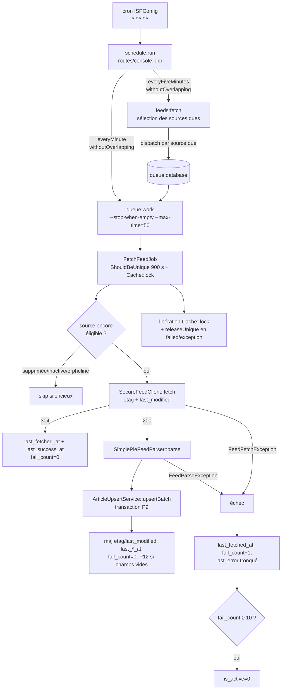

# Orchestration du collecteur RSS/Atom — Conception

> Conception produite en **M1.10.5.1** — aucune implémentation.
> Références : `Collecteur_RSS_Architecture.md` (décisions P1–P12
> actées), `DataModel.md` v3.4 (§3.2, §4.B, §4.F, §4.G), AGENTS.md.
> Ce document traduit les décisions actées en mécanismes concrets ;
> il n'en réinvente aucune.

## 1. État des lieux

### 1.1 Composants livrés et vérifiés

| Composant | Contrat réel (vérifié dans le code) |
|---|---|
| `SecureFeedClient` (`FeedClientInterface`) | `fetch(string $url, ?string $etag, ?string $lastModified): FeedFetchResult` — GET conditionnel intégré (`If-None-Match`/`If-Modified-Since`), épinglage IP, ≤ 3 redirections revalidées, 5 Mio max |
| `FeedFetchResult` | `body`, `statusCode`, `url`, `effectiveUrl`, `etag`, `lastModified`, `notModified`, `bytesRead`, `redirects` |
| `SimplePieFeedParser` (`FeedParserInterface`) | `parse(string $xml): ParsedFeed` — `FeedParseException` si non exploitable |
| `ParsedFeed` | `format`, `title`, `siteUrl`, `description`, `language`, `items: list<FeedItemData>`, `warnings` |
| `FeedItemData` | `guid`, `guidIsPermalink`, `url`, `title`, `author`, `summary`, `content`, `publishedAt`, `updatedAt` |
| `ArticleUpsertService` | `upsertBatch(Source $source, array $items): ArticleUpsertResult` — transaction P9 interne |
| `ArticleUpsertResult` | `received`, `created`, `updated`, `unchanged`, `skipped`, `collisions` |

### 1.2 Table `sources` — colonnes réelles (migration `…000002`)

| Colonne | Usage collecte |
|---|---|
| `feed_url` (UNIQUE) | URL du point de collecte, normalisée B.1 |
| `name`, `site_url`, `description` | métadonnées — enrichissement P12 si vides |
| `is_active` | sélection ; désactivation au seuil (P2) |
| `etag`, `last_modified` | validateurs HTTP stockés → GET conditionnel |
| `last_fetched_at` | horodatage de **tentative** (succès ou échec) |
| `last_success_at` | horodatage du dernier 200/304 |
| `fail_count` | échecs consécutifs → backoff P6, seuil P2 |
| `last_error` | classe + message tronqué ≤ 500 |
| `orphaned_at` | exclusion collecte (P1) |

**Aucun `next_fetch_at`** : l'échéance est **implicite** =
`last_fetched_at + delay(fail_count)` (archi §6, acté). Aucune
migration nécessaire.

### 1.3 Infrastructure réelle

- Queue : `database` (`QUEUE_CONNECTION=database`, tables `jobs`,
  `job_batches`, `failed_jobs` présentes).
- Cache : `database` (`CACHE_STORE=database`, table `cache_locks`
  présente → `Cache::lock` fonctionnel).
- `routes/console.php` : squelette par défaut — aucune planification.
- Cron ISPConfig : un seul `* * * * * php artisan schedule:run`
  (archi §2 — pas de worker persistant, AGENTS.md l'interdit).
- Fuseau : MariaDB session `+00:00`, app UTC — `now('UTC')` partout.

## 2. Architecture cible



## 3. Responsabilités

| Composant | Responsabilité unique |
|---|---|
| `feeds:fetch` (commande) | **Sélection** des sources dues + dispatch. Jamais de HTTP/parsing/persistance |
| `FetchFeedJob` (job) | **Tout le cycle d'une source** : re-vérification d'éligibilité, verrou, fetch, parse, upsert, métadonnées, backoff |
| `Source` (modèle) | Helpers d'échéance : `backoffMinutes()`, `dueAt()`, `isDue()` |
| `SecureFeedClient` | Transport uniquement — état HTTP brut |
| `SimplePieFeedParser` | XML → `ParsedFeed` |
| `ArticleUpsertService` | Articles — déjà complet, pas d'extension |
| Scheduler | Minuterie ; `queue:work` draine la file |

## 4. `FetchFeedJob` — conception détaillée

**Emplacement** : `app/Jobs/FetchFeedJob.php` (dossier prévu par
Architecture.md §4).

```php
final class FetchFeedJob implements ShouldQueue, ShouldBeUnique
{
    public $tries = 1;          // P7 : une tentative, échec dur → failed_jobs
    public $timeout = 60;       // P7 : > TOTAL_TIMEOUT cURL (15 s) + marge parse/upsert
    public $uniqueFor = 900;    // P7 : unicité 15 min = cadence de collecte
    public function __construct(public readonly int $sourceId) {}
    public function uniqueId(): string { return (string) $this->sourceId; }
}
```

- **Référence** : `sourceId` seul — la source est **relue** en
  `handle()` ; jamais de modèle sérialisé (données obsolètes, taille).
- **Re-vérification à l'exécution** (P1/P2, TOCTOU) : `Source::find` →
  `null` (supprimée), `is_active=0` (désactivée entre-temps), ou
  `orphaned_at` non NULL → **return silencieux** (compteur `skipped`
  éventuel côté log debug).
- **Verrou** : `Cache::lock('feeds:fetch:'.$sourceId, 900)` —
  `->get(fn)` : si le verrou est pris (double exécution résiduelle),
  skip. TTL 900 s aligné sur `uniqueFor` ; l'expiration automatique
  couvre le crash (le `finally`/`get` libère en fin normale).
- **handle()** :
  1. relecture + check éligibilité ;
  2. `Cache::lock->get(function() { …cycle… })` ;
  3. fetch conditionnel (`etag`, `last_modified` de la source) ;
  4. branchement 304/200/erreurs (§5) ;
  5. mise à jour des colonnes de suivi (§7 — écritures UTC).
- **Exceptions** : les `FeedFetchException`/`FeedParseException` sont
  **attendues** → capturées, enregistrées dans les colonnes, **pas de
  rethrow** (l'échec d'un flux est un état métier, pas une erreur de
  job ; `tries=1` rendrait un retry inerte). Toute autre exception
  (`QueryException`, erreur systémique P9) → **propagée** →
  `failed_jobs` (observabilité des vraies anomalies).
- **failed(Throwable)** : `releaseUnique()` explicite + log ERROR
  (`{source_id, exception_class}`) — garantit la libération du verrou
  d'unicité même si Laravel ne le libère pas sur échec.
- **Arrêt brutal** (kill worker/timeout 60 s) : `Cache::lock` expire à
  900 s, `ShouldBeUnique` expire à `uniqueFor` — un blocage temporaire
  ≤ 15 min puis reprise naturelle ; aucun verrou permanent possible.

## 5. Traitement des réponses

| Réponse | Actions |
|---|---|
| **304** (`notModified`) | Pas de parsing, pas d'upsert. `last_fetched_at` + `last_success_at` = maintenant, `fail_count=0`, `last_error=null`. `etag`/`lastModified` de la réponse persistés si présents |
| **200** | `parser->parse($body)` → `upsertBatch($source, $items)` → `etag`/`lastModified` persistés, `last_fetched_at`+`last_success_at`, `fail_count=0`, `last_error=null`, **P12** : `name`/`site_url`/`description` renseignés **uniquement si vides** |
| **Exception `FeedFetchException`** (url/dns/tls/timeout/network/http/redirect/tooLarge) | Échec : §7. Sous-classe portée dans `last_error` (nom court + message ≤ 500) |
| **`FeedParseException`** | Échec identique — flux « illisible » compté comme un échec de collecte (archi §5 : illisible ≠ vide, distingué par la classe en `last_error` et les logs) |
| **`FeedTooLargeException`** | Échec idem — c'est un `FeedFetchException` |
| **Autre `Throwable`** | Propagation → `failed_jobs` (anomalie systémique) |

P10 : aucune lecture de `Retry-After` — le backoff P6 suffit.

## 6. Éligibilité et sélection (`feeds:fetch`)

**Critères SQL** (index `(is_active, last_fetched_at)` exploité) :

```
is_active = 1
AND orphaned_at IS NULL                    -- P1
AND ( last_fetched_at IS NULL
      OR last_fetched_at + delay(fail_count) <= maintenant )   -- D12+P6
```

`delay` dépend de `fail_count` → la condition « dû » est évaluée en
**PHP** via `Source::isDue()` (voir §7) après un `->get()` borné par
`is_active`/`orphaned_at` — simple, bi-moteur, suffisant au volume
MVP (catalogue borné + sources personnelles). `chunkById(100)` si
croissance future.

**Helpers sur `Source`** (proposés — pas de migration) :

> Implémentés en M1.10.5.2 sous les noms réels `FETCH_INTERVAL_MINUTES`
> (15), `BACKOFF_MAX_MINUTES` (360), `DEACTIVATION_THRESHOLD` (10) et
> `Source::backoffMinutes(int $failCount): int` (statique) — la formule
> et les constantes proposées ci-dessous sont reprises à l'identique.

```php
public const FETCH_INTERVAL_MIN = 15;                 // D12
public const BACKOFF_MAX_MIN = 360;                   // P6
public const DEACTIVATION_THRESHOLD = 10;             // P2
public function delayMinutes(): int                   // delay(fail_count)
{ return min(self::FETCH_INTERVAL_MIN * (1 << max(0, $this->fail_count - 1)), self::BACKOFF_MAX_MIN); }
// fail_count=0 ou 1 → 15 ; 2 → 30 ; 3 → 60 ; 4 → 120 ; 5 → 240 ; ≥6 → 360
public function dueAt(): ?\Carbon\Carbon              // last_fetched_at + delay
public function isDue(): bool                         // null → due
```

**Comportement de la commande** :
`feeds:fetch` (classe `app/Console/Commands/FetchFeedsCommand.php`,
signature `feeds:fetch` — implémentée en M1.10.5.3) :

1. compte les sources éligibles et celles dues ;
2. `FetchFeedJob::dispatch($source->id)` par source due — l'unicité
   900 s rend le dispatch idempotent (un job déjà en file/sur verrou
   n'est pas repoussé) ;
3. sortie console : `{examined, eligible, dispatched, already_queued}`
   — bilan systématique (compteurs nuls si cycle vide) ;
4. `--source=<id>` optionnel (debug) : prévu à la conception, **non
   implémenté** — hors périmètre de M1.10.5.3.

## 7. Backoff, seuil, métadonnées — écritures exactes

**Succès (200 ou 304)** :

```php
$source->update([
    'last_fetched_at' => $now, 'last_success_at' => $now,
    'fail_count' => 0, 'last_error' => null,
    'etag' => $result->etag ?? $source->etag,          // validateurs
    'last_modified' => $result->lastModified ?? $source->last_modified,
]);
```

**Échec (P6 — ordre acté)** :

1. `last_fetched_at = now('UTC')` (horodatage de tentative) ;
2. `fail_count = fail_count + 1` ;
3. prochaine échéance implicite = `last_fetched_at + delay(fail_count)`
   (15, 30, 60, 120, 240, 360 min) — le sélecteur `isDue()` l'applique
   au prochain passage ;
4. `fail_count >= 10` → `is_active = 0` (P2, pas de verrou) ;
5. `last_error = classe_courte + ': ' + message tronqué ≤ 500`.

Atomicité : une seule `$source->update([...])` par issue — un UPDATE
SQL, pas de read-modify-write non atomique ; le verrou `Cache::lock`
rend la double exécution simultanée impossible.

**Réactivation** : manuelle (`is_active` repassé à 1 — UI/admin
ultérieure). Une source réactivée avec `last_fetched_at` ancien est
**immédiatement due** → reprise au prochain passage. `fail_count`
restant > 0 reprend le backoff où il était — conforme (pas de reset
implicite à la réactivation : le succès seul remet à 0).

## 8. Queue, Scheduler, cron

**Implémenté (M1.10.5.4)** — `routes/console.php` (unique fichier de
planification ; chargé par le kernel console, les événements sont
enregistrés sur le singleton `Schedule`) :

```php
Schedule::command('feeds:fetch')->everyFiveMinutes()->withoutOverlapping(15);
Schedule::command('queue:work --stop-when-empty --max-time=50')
         ->everyMinute()->withoutOverlapping(10);
```

- **Sélection** toutes les 5 min (archi §2) → latence max ~5 min sur
  une échéance de 15 min, granuleux vis-à-vis des délais de backoff.
- **Drainage** chaque minute ; `--max-time=50` < tick cron de 60 s ;
  `withoutOverlapping` couvre un cycle > 15 min (les jobs restants
  sont drainés au tick suivant — aucune perte, la queue est durable).
- `withoutOverlapping` = verrou scheduler dans `cache_locks` (store
  `database`). TTL arbitré en M1.10.6 : **15 min** pour `feeds:fetch`
  (cadence D12), **10 min** pour `queue:work` — le défaut Laravel de
  1 440 min aurait gelé une tâche jusqu'à 24 h après un kill ; un
  verrou résiduel s'efface désormais en quelques cycles.
- Aucun worker persistant, aucun service supplémentaire — conforme
  AGENTS.md (queue `database`, pas de daemon).
- Job timeout 60 s > timeouts cURL (5 s + 15 s) + parse/upsert : la
  marge est large ; le `max-time=50` du worker est un plafond de
  **durée de vie du processus**, pas du job (un job > 50 s de travail
  ne l'empêche pas de terminer — `--stop-when-empty` termine proprement
  le job courant).

### 8.1 Cron ISPConfig — installé et actif

Une seule entrée cron, exécutée sous l'utilisateur système effectif
`web18` (SSH `veille_usr`), appelée chaque minute. **Installée dans
ISPConfig et vérifiée en fonctionnement** (exécution minute confirmée
dans les journaux système et `storage/logs/schedule.log`) :

```
* * * * * cd /var/www/clients/client2/web18/private/veille && /usr/bin/php8.3 artisan schedule:run >> /var/www/clients/client2/web18/private/veille/storage/logs/schedule.log 2>&1
```

| Élément | Valeur vérifiée |
|---|---|
| Binaire PHP CLI | `/usr/bin/php8.3` — PHP 8.3.36 (cli) NTS |
| `php` générique | `/usr/bin/php` → `/etc/alternatives/php` → `/usr/bin/php8.3` (le chemin explicite reste recommandé : pas de dérive d'alternatives) |
| Répertoire de travail | `/var/www/clients/client2/web18/private/veille` |
| Journal | `storage/logs/schedule.log` — `storage/logs` appartient à `web18` et est inscriptible ; `~/log/` est géré par ISPConfig et **non inscriptible** par `web18` |
| Utilisateur effectif | `web18` (compte `veille_usr`) |
| Fréquence | `* * * * *` (chaque minute) |

Installée via la crontab utilisateur ISPConfig du site en M1.10.6 ;
exécution minute confirmée sous `web18`.

### 8.2 Vérification et diagnostic

```bash
php artisan schedule:list      # les deux tâches et leurs fréquences
php artisan schedule:run       # exécution manuelle d'un cycle
php artisan queue:work --stop-when-empty --max-time=50   # drainage manuel
php artisan queue:failed       # jobs en échec définitif
php artisan feeds:fetch        # bilan sélection/dispatch d'un cycle
```

Vérifié en M1.10.5.4 : `schedule:list` affiche `*/5 * * * *` pour
`feeds:fetch` et `* * * * *` pour `queue:work --stop-when-empty
--max-time=50`.

## 9. Concurrence — récapitulatif des barrières

| Barrière | Rôle | Durée |
|---|---|---|
| `ShouldBeUnique` (`sourceId`, 900 s) | Empêche **dispatch** et exécution doublés | 900 s |
| `Cache::lock` (900 s, `->get()`) | Empêche l'**exécution** parallèle (course résiduelle) | 900 s, libérée en `finally` |
| `withoutOverlapping` scheduler | Pas de `feeds:fetch` ni `queue:work` concurrents | cycle |
| `UNIQUE(source_id, dedup_key)` | Dernière barrière de persistance (articles) | — |
| `UNIQUE(feed_url)` | Identité technique de la source | — |

Double verrou acté (P7) : `ShouldBeUnique` couvre la fenêtre
dispatch→exécution ; `Cache::lock` couvre l'exécution elle-même.
Aucune combinaison ne produit de collecte parallèle d'une même source.

## 10. Observabilité (archi §8 — inchangée)

| Niveau | Événement | Champs |
|---|---|---|
| INFO | source collectée | `source_id, status (200/304), duration_ms, items_new, items_updated, items_skipped` |
| WARNING | échec de source | `source_id, error_class, fail_count` |
| ERROR | anomalie dédup (déjà dans `ArticleUpsertService`) ; `failed()` du job | `source_id`, détail court |
| INFO | commande, si `due > 0` | `eligible, due, dispatched` |

Jamais : corps de flux, en-têtes d'auth, contenu d'article, données
personnelles. `feed_url` et message tronqué suffisent.

## 11. Gestion des erreurs et reprise

| Événement | État | Reprise |
|---|---|---|
| Échec HTTP/DNS/TLS/timeout/parse | `fail_count+1`, `last_error`, backoff | automatique à l'échéance |
| 10ᵉ échec | `is_active=0` | réactivation manuelle seule |
| Kill worker pendant un job | verrous expirent ≤ 900 s | job reprogrammé au prochain cycle (unicité expirée) |
| Échec systémique (P9 rollback, QueryException) | job → `failed_jobs`, `releaseUnique` | diagnostic via `queue:failed`, retry manuel `queue:retry` |
| 304 permanent | compteurs à 0, cycle normal | — |

## 12. Tests prévus par mission

- **M1.10.5.2** (job, Feature bi-moteur) : 200 → articles + `fail_count=0`
  + validateurs persistés + P12 (champs vides remplis, existants
  intacts) ; 304 → pas de parse (parser faké), champs maj ; erreur →
  `fail_count+1` + `last_error` ; seuil 10 → `is_active=0` ; source
  supprimée/inactive/orpheline à l'exécution → skip ; `Cache::lock`
  pris → skip ; `FeedClientInterface` faké par injection.
- **M1.10.5.3** (commande) : sélection due/pas-due/inactive/orpheline
  (`last_fetched_at` fixés par état) ; compteurs console ; dispatch
  idempotent (deux passages → un seul exécute).
- **M1.10.5.4** (scheduler) : présence des deux entrées
  `Schedule::command` (test de config ou revue) ; `queue:work`
  drain effectif vérifié manuellement.
- **M1.10.5.5** (E2E) : cycle complet sur client HTTP faké ; backoff
  15→360 min (fail_count simulés) ; réactivation → collecte
  immédiate ; crash simulé (verrou persistant) → reprise ≤ 900 s ;
  `failed_jobs` après erreur systémique.

## 13. Risques et résidus

- `shouldBeUnique` libère son verrou à l'**exécution**, pas à la
  fin — `Cache::lock` couvre la suite ; `releaseUnique()` en `failed()`.
- `queue:work --max-time=50` en `--stop-when-empty` : le job courant
  termine proprement ; file résiduelle = tick suivant. Accepté.
- Pas de `next_fetch_at` : `isDue()` recalcule l'échéance — cohérent
  avec archi §6 ; si le volume l'exige un jour, une colonne calculée
  serait une évolution séparée (pas de migration dans M1.10).
- Sources dont le DNS reste mixte public/privé : toujours rejetées
  (P3) — échecs comptés comme les autres, backoff normal.
- `FeedItemData->updatedAt` : inutilisé par le collecteur actuel
  (champ mutables §4.B) — conservé pour évolutions.

## 14. Découpage des missions d'implémentation

| Mission | Livrable | Critère de validation |
|---|---|---|
| **M1.10.5.2** | `FetchFeedJob` + helpers `Source` (`backoffMinutes`, `dueAt`, `isDue`) | Suite job verte bi-moteur (cas §12) |
| **M1.10.5.3** | `feeds:fetch` (`FetchFeedsCommand`) | Sélection et compteurs testés ; aucun HTTP dans la commande |
| **M1.10.5.4** | `routes/console.php` + doc cron | Entrées scheduler vérifiées ; `schedule:list` |
| **M1.10.5.5** | Tests E2E collecte + backoff + reprise | Cycle complet démontré bi-moteur |
| **M1.10.6** | Revue, contrôles, commits, docs | `pint`/`phpstan`/tests verts ; commit(s) validé(s) |

## 15. Migrations nécessaires

**Aucune.** Toutes les colonnes de suivi existent (`sources` §3.2) ;
`jobs`, `failed_jobs`, `cache_locks` sont déployées. L'échéance reste
implicite (`last_fetched_at + delay`), comme acté.
